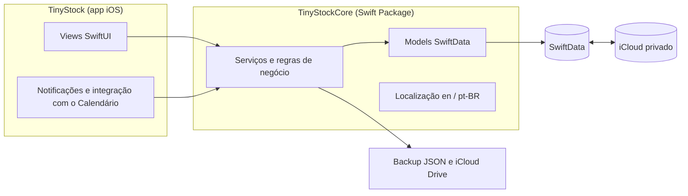
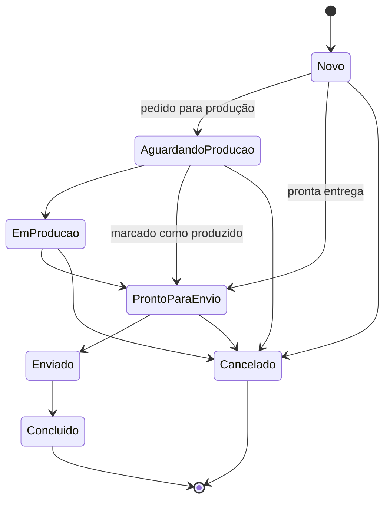
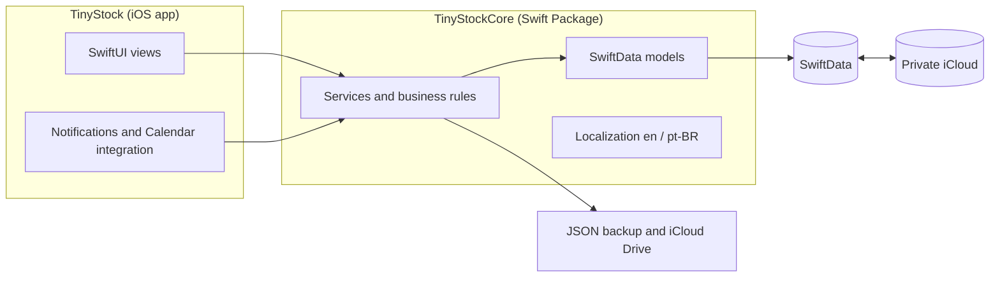
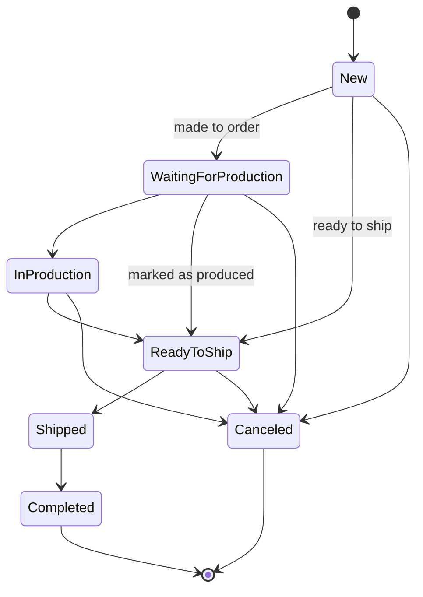

# &nbsp;&nbsp;TinyStock&nbsp;

**[Read in English](#en-tinystock)**

_Organize estoque de produtos, pedidos e vendas do seu pequeno negócio._

O TinyStock foi criado para pequenos negócios feitos à mão, como o crochê da minha mãe e meus produtos impressos em 3D, cujo estoque já não cabia numa planilha.

Cadastre seus produtos com custo de produção e preço. Cada venda vai para um calendário, e os relatórios mostram quantas vendas você fez e quanto lucrou.

Dá para ter mais de uma loja, cada uma com seus produtos, e as notificações avisam o que precisa de atenção.

O app tem o ciclo operacional completo de uma pequena loja: cadastro de produtos com variações, controle de estoque auditável, pedidos de pronta entrega ou sob encomenda, prazos de produção e despacho no calendário e relatórios financeiros por período.

## Funcionalidades
_(O app está nos testes finais, algumas funcionalidades podem ser removidas ou novas serem adicionadas até a versão final. Qualquer dúvida ou sugestão, entre em [contato comigo](https://jonathasmotta.com).)_

**Lojas**
- Várias lojas independentes, com troca rápida entre elas.
- Arquivamento e lixeira com restauração por 30 dias.

**Produtos e estoque**
- Produtos com foto, preço de venda, custo e lucro por unidade.
- Variações opcionais (cor, tamanho, modelo), cada uma com seu próprio saldo.
- Toda alteração de estoque gera uma movimentação registrada, o que permite auditar entradas, saídas e ajustes.

**Pedidos**
- Pedidos de pronta entrega ou para produção.
- Canais de venda: venda direta, Shopee, Mercado Livre ou outro canal personalizado, com cálculo de taxas.
- Fluxo de status: novo, aguardando produção, em produção, pronto para envio, enviado, concluído ou cancelado.
- Baixa automática do estoque e registro do retrato financeiro de cada pedido (preço, custo e taxa no momento da venda).

**Calendário e lembretes**
- Calendário interno com prazos de produção e despacho, filtros e atalhos.
- Notificações locais de produção e despacho.
- Exportação dos compromissos para o app Calendário do iPhone.

**Relatórios**
- Receita, custos, taxas e lucro líquido por loja e período.
- Desempenho por canal de venda e produtos mais vendidos.

**Dados e personalização**
- Sincronização automática e privada pelo iCloud (CloudKit).
- Backup em JSON para exportar e importar, além de cópia manual no iCloud Drive.
- Cores de destaque configuráveis.
- Interface em Português do Brasil e English, conforme o idioma do iPhone.
- Suporte a VoiceOver, Dynamic Type, modo claro e modo escuro.

## Arquitetura



- **SwiftUI** para toda a interface.
- **SwiftData** para persistência local, com sincronização pelo **CloudKit** em banco privado do usuário.
- **TinyStockCore**: Swift Package local que concentra models, regras de negócio, serviços, localização e testes. O app fica responsável apenas pela interface e pela integração com o sistema, o que mantém o Core testável e reutilizável em futuras extensões, como widgets.
- **Decimal** em todos os valores monetários, evitando erros de arredondamento.
- **Swift Testing** para os testes automatizados do Core.
- Nenhuma dependência externa: apenas frameworks nativos da Apple.

### Ciclo de um pedido



## Estrutura do repositório

```text
iOS/TinyStock/
├── TinyStock/                 App iOS
│   ├── Views/                 Telas por área: Produtos, Calendário, Relatórios e Ajustes
│   ├── Notifications/         Lembretes locais e navegação a partir das notificações
│   └── Resources/             Info.plist e textos do sistema localizados
├── TinyStockCore/             Swift Package com o domínio do app
│   ├── Sources/TinyStockCore/
│   │   ├── Models/            Lojas, produtos, variações, estoque e pedidos
│   │   ├── Services/          Regras de estoque, pedidos, relatórios, lembretes e backup
│   │   ├── Persistence/       Configuração do SwiftData e do CloudKit
│   │   └── Resources/         Localização en e pt-BR
│   └── Tests/                 Testes automatizados do Core
└── TinyStock.xcodeproj
```

## Requisitos

- iOS 26 ou superior.
- Xcode 27 ou superior.
- Swift 6.

Para executar em um iPhone com sincronização, selecione o seu Team e configure o container do iCloud em **Signing & Capabilities**.

## Privacidade

O TinyStock não exige cadastro e não envia dados ao desenvolvedor. As informações ficam no próprio dispositivo e, quando a sincronização está ativa, na conta privada do iCloud do usuário. Não há servidores próprios, ferramentas de análise ou anúncios.


## Autor

Desenvolvido por **Jonathas Motta** ([@jonathaxs](https://github.com/jonathaxs)).

---

# &nbsp;&nbsp;(EN) TinyStock&nbsp;

**[Leia em português](#tinystock)**

_Organize product stock, orders and sales for your small business._

TinyStock was created for small handmade businesses, like my mom's crochet and my 3D printed products, whose stock no longer fit in a spreadsheet.

Add your products with their production cost and price. Each sale goes on a calendar, and the reports show how many sales you made and how much profit you earned.

You can have more than one store, each with its own products, and notifications let you know what needs attention.

The app covers the full operating cycle of a small store: a product catalog with variants, auditable stock control, ready-to-ship or made-to-order orders, production and shipping deadlines on the calendar and financial reports by period.

## Features
_(The app is in final testing, so some features may be removed or new ones added before the final version. For questions or suggestions, [get in touch](https://jonathasmotta.com).)_

**Stores**
- Multiple independent stores, with quick switching between them.
- Archive and trash, with restore for 30 days.

**Products and stock**
- Products with a photo, sale price, cost and profit per unit.
- Optional variants (color, size, model), each with its own stock count.
- Every stock change creates a logged movement, so incoming, outgoing and adjustments can be audited.

**Orders**
- Ready-to-ship or made-to-order orders.
- Sales channels: direct sale, Shopee, Mercado Livre or a custom channel, with fee calculation.
- Status flow: new, waiting for production, in production, ready to ship, shipped, completed or canceled.
- Automatic stock deduction and a financial snapshot of each order (price, cost and fee at the time of sale).

**Calendar and reminders**
- Built-in calendar with production and shipping deadlines, filters and shortcuts.
- Local notifications for production and shipping.
- Export of events to the iPhone Calendar app.

**Reports**
- Revenue, costs, fees and net profit by store and period.
- Performance by sales channel and best-selling products.

**Data and personalization**
- Automatic, private sync through iCloud (CloudKit).
- JSON backup to export and import, plus a manual copy to iCloud Drive.
- Configurable accent colors.
- Interface in Brazilian Portuguese and English, following the iPhone's language.
- Support for VoiceOver, Dynamic Type, light mode and dark mode.

## Architecture



- **SwiftUI** for the whole interface.
- **SwiftData** for local persistence, synced through **CloudKit** in the user's private database.
- **TinyStockCore**: a local Swift Package that holds the models, business rules, services, localization and tests. The app only handles the interface and system integration, which keeps the Core testable and reusable in future extensions, such as widgets.
- **Decimal** for every money value, avoiding rounding errors.
- **Swift Testing** for the Core's automated tests.
- No external dependencies: only Apple's native frameworks.

### Order lifecycle



## Repository structure

```text
iOS/TinyStock/
├── TinyStock/                 iOS app
│   ├── Views/                 Screens by area: Products, Calendar, Reports and Settings
│   ├── Notifications/         Local reminders and navigation from notifications
│   └── Resources/             Info.plist and localized system strings
├── TinyStockCore/             Swift Package with the app's domain
│   ├── Sources/TinyStockCore/
│   │   ├── Models/            Stores, products, variants, stock and orders
│   │   ├── Services/          Stock, order, report, reminder and backup rules
│   │   ├── Persistence/       SwiftData and CloudKit setup
│   │   └── Resources/         en and pt-BR localization
│   └── Tests/                 Core automated tests
└── TinyStock.xcodeproj
```

## Requirements

- iOS 26 or later.
- Xcode 27 or later.
- Swift 6.

To run it on an iPhone with sync, select your Team and set up the iCloud container in **Signing & Capabilities**.

## Privacy

TinyStock requires no sign-up and sends no data to the developer. Information stays on the device and, when sync is on, in the user's private iCloud account. There are no servers of its own, no analytics and no ads.

## Author

Developed by **Jonathas Motta** ([@jonathaxs](https://github.com/jonathaxs)).
